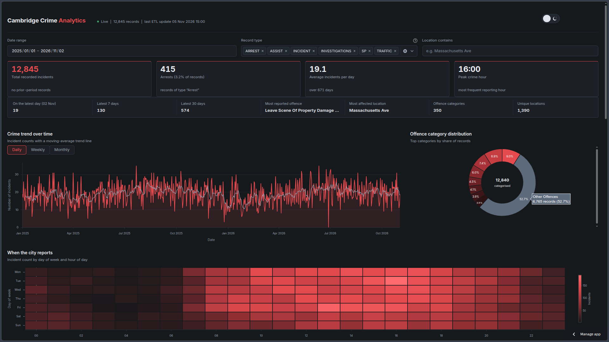

# Cambridge Crime Data Pipeline

An end-to-end data pipeline that collects incident records from the Cambridge Police Department's public data, prepares them for analysis, and presents the results in an interactive Streamlit dashboard.

I built this project to get hands-on experience with the full data engineering workflow — from pulling data from an API to storing it in a database and making the results useful through visualisations.

**Live dashboard:** [Cambridge Crime Analytics](https://cambridge-crime-data-pipeline.streamlit.app/)  
**GitHub repository:** [Nishanta04/cambridge-crime-data-pipeline](https://github.com/Nishanta04/cambridge-crime-data-pipeline)

## Dashboard

The dashboard brings the main trends and recent incident records together in one place. It includes date and record-type filters, summary statistics, time-based analysis, offence breakdowns, and an incident feed.



## What it does

The pipeline follows an extract, transform, and load (ETL) workflow:

1. **Extract** – Fetches Cambridge Police Department incident data from the Socrata Open Data API.
2. **Validate** – Checks the incoming records and handles missing or invalid values.
3. **Transform** – Cleans the data, removes duplicate records, and derives useful date and time fields for analysis.
4. **Load** – Stores the processed records in a PostgreSQL database. The load process is designed to avoid inserting the same incident more than once.
5. **Visualise** – Reads the stored data and displays interactive analytics through Streamlit.

The pipeline is also set up for scheduled execution, so the dataset can be refreshed without having to run the process manually each day.

## Dashboard features

- Filter records by date range and record type.
- Search for incidents by location.
- View headline figures such as total incidents, arrests, and average incidents per day.
- Explore incident trends over time, with daily, weekly, and monthly views.
- Compare activity by hour of day and day of week.
- See offence-category distribution and activity patterns in a day-versus-hour heatmap.
- Review recent records in the incident table.

The figures and charts are generated from the database records and respond to the selected filters.

## Tech stack

| Tool | How it is used |
| --- | --- |
| Python | Main language for the pipeline and dashboard |
| Pandas | Data cleaning, transformation, and aggregation |
| Socrata API | Source of Cambridge Police Department incident data |
| SQLAlchemy | Database interaction |
| PostgreSQL (Neon) | Stores the processed incident records |
| Streamlit | Interactive dashboard |
| Plotly | Interactive charts and visualisations |
| GitHub Actions | Scheduled pipeline execution |

## Running it locally

### 1. Clone the repository

```bash
git clone https://github.com/Nishanta04/cambridge-crime-data-pipeline.git
cd cambridge-crime-data-pipeline
```

### 2. Create and activate a virtual environment

```bash
python -m venv .venv
source .venv/bin/activate
```

On Windows, activate it with:

```powershell
.venv\Scripts\activate
```

### 3. Install dependencies

```bash
pip install -r requirements.txt
```

### 4. Configure environment variables

Create a `.env` file in the project root. Add the values required by your local setup:

```env
DATABASE_URL=your_postgresql_connection_string
SOCRATA_APP_TOKEN=your_socrata_app_token
```

`SOCRATA_APP_TOKEN` may be optional depending on the API usage and configuration. A token is useful when you need an application-specific Socrata API connection.

If your setup uses Prefect, add the relevant Prefect variables as well:

```env
PREFECT_API_URL=your_prefect_api_url
PREFECT_API_KEY=your_prefect_api_key
```

Keep `.env` out of Git. Do not commit database credentials, API tokens, or other secrets. Use the deployment platform's secrets or environment-variable settings for hosted runs.

### 5. Start the dashboard

```bash
streamlit run dashboard.py
```

Streamlit will print a local URL in the terminal, usually `http://localhost:8501`.

### 6. Run the ETL pipeline

Run the project's ETL entry point using the command configured in the repository or trigger the scheduled GitHub Actions workflow manually from the **Actions** tab. The workflow is configured to run automatically on its schedule.

> The dashboard needs a working database connection and processed records to display the analytics.

## Deployment

The dashboard is deployed on Streamlit Community Cloud and uses a PostgreSQL database hosted on Neon. The daily ETL workflow is configured through GitHub Actions.

For deployment, make sure the required environment variables are configured in the hosting platform. Never place credentials directly in the source code or in `config.toml`.

## A note about the data

This project uses publicly available Cambridge Police Department incident records. The dashboard is intended for exploring patterns in the published data; it should not be treated as a measure of all crime or as a substitute for official reporting. Records can be updated or corrected by the source, and the dashboard reflects the data available to the pipeline.
